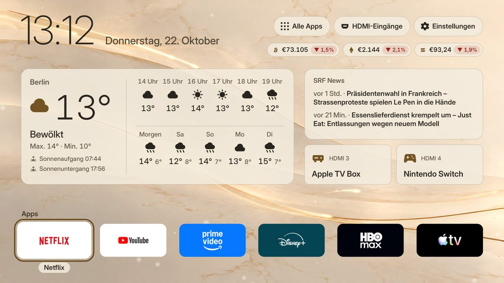
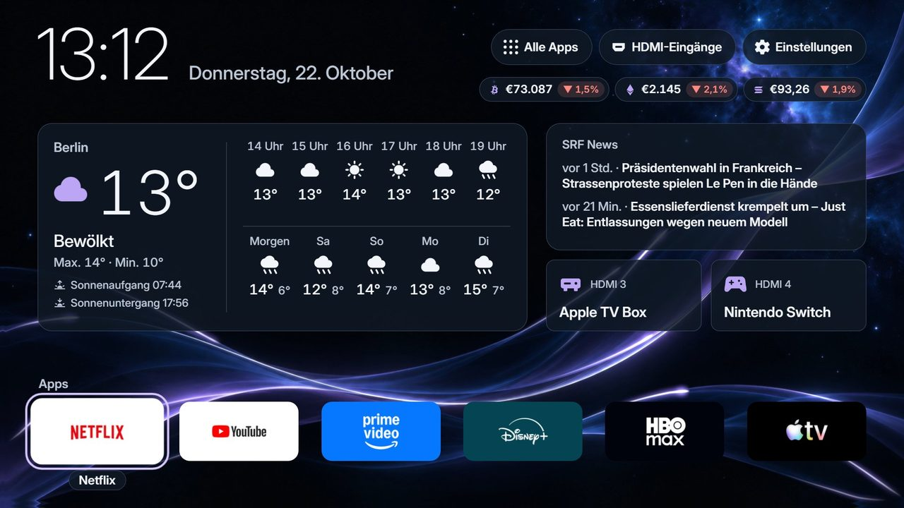
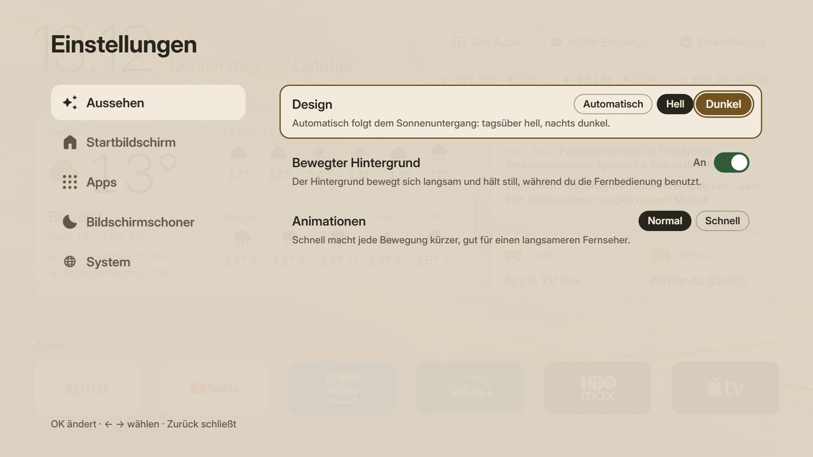
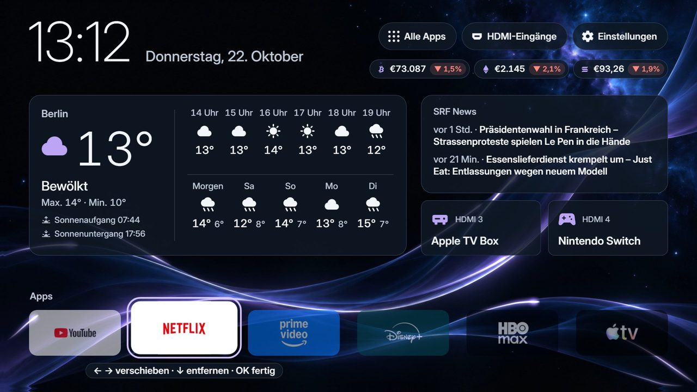
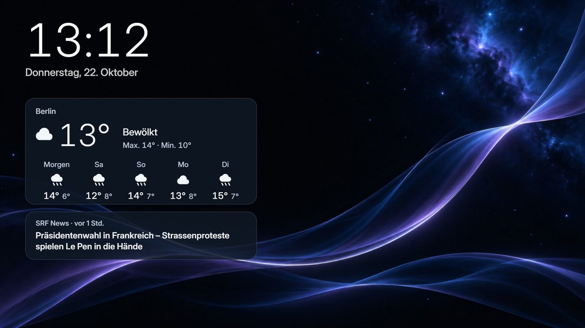

<div align="center">


# Free My TV für LG

**Ein schneller, werbefreier Startbildschirm für LG-Fernseher (webOS).**

Deine Apps groß und übersichtlich, Wetter für 5 Tage, die neuesten SRF-Schlagzeilen und ein Bildschirmschoner mit Uhr und Wetter.<br>
Gebaut für Leute, die vor allem YouTube und Netflix schauen und sich nicht durch LGs Werbe-Startseite klicken wollen.

[**⬇ App herunterladen**](https://github.com/Lampe332/free-my-tv-lg/releases/latest) · [Anleitung](#installieren-schritt-für-schritt) · [Bedienung](#bedienung) · [Fragen](#häufige-fragen)



</div>

## Was die App kann

- **Keine Werbung.** Keine gesponserten Reihen, keine Banner, keine Videos, die von selbst starten.
- **Deine Apps vorne.** Netflix, YouTube, Prime Video, Disney+ und Co. in einer Leiste. Reihenfolge änderst du direkt mit der Fernbedienung (OK lange drücken).
- **Wetter auf einen Blick.** Jetzt, die nächsten Stunden und die nächsten 5 Tage, dazu Sonnenauf- und -untergang.
- **SRF News.** Die neuesten Schlagzeilen, alle 10 Minuten frisch.
- **Tags hell, nachts dunkel.** Wechselt mit dem echten Sonnenuntergang, mit bewegtem Hintergrund.
- **Home-Taste, die mitdenkt.** Hast du YouTube aus Free My TV geöffnet, bringt dich Home wieder zurück zu Free My TV und nicht zu LGs Startseite.
- **Eigener Bildschirmschoner.** Uhr, Wetter und die neueste Schlagzeile. Der LG-Bildschirmschoner bleibt dann weg.
- **Geräte am HDMI.** Apple TV, Konsole und Co. erscheinen als Karten und sind mit einem Druck auf OK an.
- **Ändert nichts am Fernseher.** Es ist eine ganz normale App. LGs Startseite bleibt, wo sie ist.

<table>
<tr>
<td></td>
<td></td>
</tr>
<tr>
<td></td>
<td></td>
</tr>
</table>

## Was du brauchst

- Einen **LG-Fernseher mit webOS** (getestet auf einem LG OLED B5 mit webOS 25) im gleichen WLAN wie dein Computer.
- Einen **Computer** (Windows, Mac oder Linux).
- Ein **kostenloses LG-Entwicklerkonto**. Dauert 2 Minuten, siehe Schritt 1.
- Etwa **15 Minuten**.

Kein Rooten, kein Basteln am Fernseher: Free My TV wird über LGs offiziellen **Entwicklermodus** installiert.

## Installieren: Schritt für Schritt

### Schritt 1: LG-Entwicklerkonto anlegen (am Computer)

1. Öffne [webostv.developer.lge.com](https://webostv.developer.lge.com) und klicke oben rechts auf **Sign In**.
2. Lege ein Konto an (**Create Account**) und bestätige deine E-Mail-Adresse.
3. Merk dir E-Mail und Passwort, du brauchst sie gleich am Fernseher.

### Schritt 2: „Developer Mode“-App auf dem Fernseher installieren

1. Drücke am Fernseher **Home** und öffne den **LG Content Store** (je nach Modell auch „Apps“).
2. Suche nach **Developer Mode** und installiere die App.
3. Öffne **Developer Mode** und melde dich mit dem Konto aus Schritt 1 an.

### Schritt 3: Entwicklermodus einschalten

1. Schalte in der Developer-Mode-App **Dev Mode Status** auf **ON**.
2. Der Fernseher fragt, ob er neu starten soll: **Ja**. Er startet neu.
3. Öffne **Developer Mode** wieder und schalte **Key Server** auf **ON**.
4. Lass die App offen. Dort steht jetzt die **IP-Adresse** des Fernsehers (z. B. `192.168.1.50`) und eine **Passphrase** aus 6 Zeichen. Beides brauchst du in Schritt 5.

> **Tipp:** Der Key Server geht nach einem Neustart des Fernsehers manchmal wieder aus. Schalte ihn vor dem Installieren einfach nochmal ein.

### Schritt 4: App herunterladen

Lade **[FreeMyTV-webos.ipk](https://github.com/Lampe332/free-my-tv-lg/releases/latest/download/FreeMyTV-webos.ipk)** herunter. Das ist die App-Datei, sie liegt immer unter [Releases](https://github.com/Lampe332/free-my-tv-lg/releases/latest).

### Schritt 5: App auf den Fernseher bringen

Du hast zwei Wege. **Weg A** ist ein Programm mit Fenster, **Weg B** ein kleines Skript.

#### Weg A: mit „webOS Dev Manager“ (ohne Programmieren)

Ein kostenloses Programm der webOS-Homebrew-Community (nicht von LG).

1. Lade den **webOS Dev Manager** für deinen Computer herunter: [github.com/webosbrew/dev-manager-desktop/releases](https://github.com/webosbrew/dev-manager-desktop/releases) (für Windows die Datei mit `.msi` oder `.exe`).
2. Installiere und öffne ihn.
3. Füge deinen Fernseher hinzu (**Add Device**): Gib die **IP-Adresse** aus Schritt 3 ein, wähle **Developer Mode** und tippe die **Passphrase** ein.
4. Gehe zu **Apps** und klicke auf **Install** (Pfeil-Symbol). Wähle die heruntergeladene `FreeMyTV-webos.ipk`.
5. Fertig: Free My TV erscheint in der App-Liste deines Fernsehers.

#### Weg B: mit dem Install-Skript (Python)

1. Installiere **Python 3** von [python.org](https://www.python.org/downloads/). Unter Windows beim Installieren **„Add python.exe to PATH“** anhaken. Das nötige `ssh` haben Windows 10/11, Mac und Linux schon dabei.
2. Lade dieses Projekt herunter: oben auf dieser Seite **Code → Download ZIP** und entpacke es.
3. Lege die `FreeMyTV-webos.ipk` aus Schritt 4 in den entpackten Ordner (neben `README.md`).
4. Öffne in diesem Ordner ein Terminal (Windows: im Ordner oben in die Adresszeile `cmd` tippen und Enter) und gib ein, mit der IP deines Fernsehers:
   ```
   python webos/install.py 192.168.1.50
   ```
5. Beim ersten Mal fragt das Skript nach der **Passphrase** aus Schritt 3: eintippen, Enter. Die App wird installiert und öffnet sich auf dem Fernseher.

Für spätere Updates reicht derselbe Befehl, ohne Passphrase.

### Schritt 6: Erster Start

1. Öffne **Free My TV** auf dem Fernseher (App-Liste).
2. Der Fernseher fragt einmal: **„Das Mobilgerät will sich mit dem Fernsehgerät verbinden“**. Das ist Free My TV selbst: wähle **Ja / Zulassen**.
   So weiß die App, welche App gerade läuft, und die **Home-Taste bringt dich zurück zu Free My TV**. Wenn du Nein drückst, geht alles andere trotzdem.

### Schritt 7: Auf eine Zifferntaste legen (empfohlen)

Damit Free My TV immer nur einen Tastendruck entfernt ist:

1. Öffne Free My TV.
2. Halte eine **Zifferntaste** auf der Fernbedienung gedrückt, z. B. die **1**, bis der Fernseher sie zuweist.
3. Ab jetzt öffnet **1 lange drücken** Free My TV, egal wo du bist.

## Bedienung

| Taste | Was passiert |
|---|---|
| ◀ ▶ ▲ ▼ | Auswahl bewegen |
| **OK** | App öffnen, Gerät einschalten, Einstellung wählen |
| **OK lange drücken** auf einer App | App aufheben: mit ◀ ▶ verschieben, ▼ entfernt sie aus der Leiste, OK legt sie ab |
| **▼** auf der App-Leiste | Leiste mit Eingängen (HDMI), „Alle Apps“, Einstellungen |
| **Zurück** | Schließt, was offen ist |
| **Home** in einer App, die du aus Free My TV geöffnet hast | Zurück zu Free My TV |
| **Home** in Free My TV | LGs eigene Startseite |

**Einstellungen** (oben rechts, oder ▼ → Einstellungen) haben fünf Gruppen:

- **Aussehen:** hell, dunkel oder automatisch, bewegter Hintergrund, Animationen.
- **Startbildschirm:** Wetter, News, Geräte-Karten und Krypto-Kurse an oder aus.
- **Apps:** welche Apps in die Leiste kommen, „Apps verschieben“.
- **Bildschirmschoner:** nach 5, 10 oder 30 Minuten oder aus, „Jetzt zeigen“.
- **System:** Sprache, °C/°F, Home-Taste an oder aus, TV-Einstellungen.

## Wichtig zu wissen

- **Entwicklermodus läuft ab:** LG gibt jeweils 1000 Stunden (gut 40 Tage). Öffne ab und zu die App **Developer Mode** und drücke **Extend** (verlängern). Läuft er ab, entfernt der Fernseher Free My TV. Dann einfach Schritt 3 bis 5 wiederholen.
- **Wetter-Ort:** Die fertige App nimmt die Stadt aus der Zeitzone des Fernsehers (in der Schweiz z. B. Zürich). Für deinen genauen Ort siehe [Selbst bauen](#selbst-bauen-für-fortgeschrittene).
- **LGs Startseite blitzt kurz auf:** Drückst du in YouTube Home, zeigt der Fernseher zuerst für etwa eine halbe Sekunde seine eigene Startseite, dann holt sich Free My TV den Bildschirm zurück. Ohne Rooten lässt sich das nicht ganz verhindern.
- **Nach langem Schauen** (z. B. YouTube in 4K) beendet der Fernseher Free My TV manchmal, um Speicher frei zu machen. Dann ist der Bildschirm nach Home kurz schwarz, bis die App neu gestartet ist.

## Häufige Fragen

**Die Installation findet den Fernseher nicht.**
Fernseher und Computer müssen im selben WLAN sein. In der Developer-Mode-App muss **Key Server** auf ON stehen. Prüfe die IP-Adresse, sie steht in der Developer-Mode-App.

**„Passphrase falsch“ oder der Schlüssel klappt nicht.**
Tippe genau die Passphrase ab, die gerade in der Developer-Mode-App steht (Groß- und Kleinschreibung beachten).

**Home bringt mich nicht zurück zu Free My TV.**
Beim ersten Start musste die Verbinden-Frage mit **Ja** beantwortet werden. Hast du Nein gedrückt: **Einstellungen → System → Home-Taste**, dort fragt OK nochmal.

**Eine App fehlt in der Leiste.**
**Einstellungen → Apps**: dort sind alle Apps des Fernsehers, einfach anhaken.

**Ich will Free My TV wieder loswerden.**
Im webOS Dev Manager unter **Apps** löschen, oder mit dem Skript: `python webos/install.py 192.168.1.50 --uninstall`. Danach kannst du in der Developer-Mode-App **Dev Mode Status** ausschalten.

## Selbst bauen (für Fortgeschrittene)

Mit eigenem Ort für das Wetter (und optional einem TMDB-Schlüssel für Film-Tipps):

1. Projekt herunterladen (Code → Download ZIP oder `git clone`).
2. Für die Hintergründe `theme.zip` aus den [Releases](https://github.com/Lampe332/free-my-tv-lg/releases/latest) in einen Ordner `theme/` im Projekt entpacken. Ohne sie gibt es das schlichte Design.
3. `python webos/build.py` einmal ausführen. Es legt `config.properties` an: dort `city`, `latitude` und `longitude` eintragen (Dezimalgrad, z. B. `47.37` / `8.54`).
4. Nochmal `python webos/build.py`. Es endet mit `Built FreeMyTV-webos.ipk`.
5. Installieren wie in [Weg B](#weg-b-mit-dem-install-skript-python): `python webos/install.py <IP>`.

`config.properties` bleibt bei dir und kommt nie ins Repo. Vorschau im Browser: `python webos/build.py --preview`, dann `out/webos/index.html` öffnen.

## Herkunft und Lizenz

- Basiert auf **[Free My TV](https://github.com/simbasjungles/free-my-tv)** von simbasjungles und Mitwirkenden (MIT-Lizenz). Dort gibt es auch die Versionen für **Google TV / Android TV** und **Samsung**. Ihr Code ist in diesem Repo weiterhin enthalten (`app/`, `tizen/`).
- Diese LG-Version bringt dazu: neues Design mit bewegten Hintergründen, 5-Tage-Wetter, SRF News, neue Einstellungen, Apps verschieben per langem OK-Druck, den Bildschirmschoner mit Wetter, die Home-Taste zurück zu Free My TV (über einen kleinen Hintergrund-Dienst, `webos/service/`) und einen schnelleren Wechsel zurück aus anderen Apps.
- Hintergründe: **[Flowing Light](https://github.com/Lampe332/flowing-light-backgrounds)** (CC0).
- Lizenz: [MIT](LICENSE).
